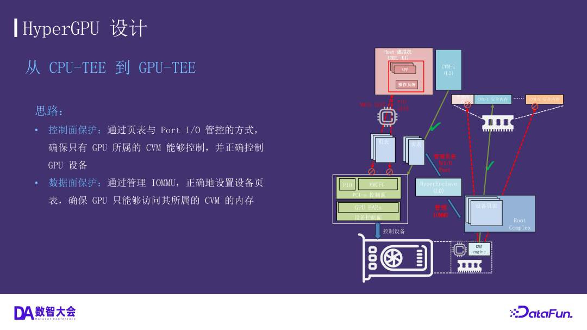

# 设备/GPU 隔离实现设计（src/device/）

> **文档定位**：本文档是 `src/device/` 设备隔离模块（2026-10 落地，未随 v2 PR1–PR5 序列编号）的实现级设计说明，与《RustMonitor 设计架构》§6.5（HyperGPU L0/L1/L2 模型、控制面/数据面）和《v2 实现设计》配套阅读。模块纯逻辑均有宿主机单元测试覆盖，代码为唯一事实来源。
>
> **一句话概括**：monitor 抢在 Linux 枚举 PCI 总线之前，自行识别出独立计算加速卡（数据中心 GPU / NPU / DCU），然后从**控制面**（host 驱动不到它）与**数据面**（它 DMA 不到任何地方）两个方向同时收权，直到 monitor 把它显式指派给某个受保护的属主。

---

## 1. 目标与威胁模型

**目标**：host（降级后的 Linux）是**不可信**的一方。独立加速卡必须满足：

1. host **无法驱动**它——配置空间与 BAR 在 host 的内存视图中不存在，Linux 枚举时读到 vendor id `0xFFFF`，判定"无设备"，永不绑定驱动；
2. host **无法利用它做 DMA**——设备被移入独立的空 IOMMU 域，任何 DMA 请求直接 fault；
3. 只有在 monitor 显式 `assign` 之后，设备才对被指派的属主可用；`release` 之后立即回到 fail-closed；
4. **机器上的其余一切设备行为与 monitor 加载前完全一致**——网卡、存储、USB、尤其是驱动控制台的核显，一律原样直通。

威胁模型与 HyperGPU 材料一致（见 [rustmonitor-architecture.md §6.5.5](rustmonitor-architecture.md)）：可抵御高特权软件攻击（host root 管理员越权、恶意设备 DMA）；不考虑硬件攻击（冷启动、PCIe 链路窃听）、侧信道与 DoS。隔离 VM 内存不含按域硬件加密，机密性由页表结构性隔离承担。

**关键时序前提**：这一切之所以可能，是因为 monitor 的枚举发生在 host 自己的 PCI 枚举**之前**——`device::init()` 在 `cell::init()` 内运行，此时 Linux 还停在 `primary_init_late` 的屏障上（[src/device/mod.rs](../src/device/mod.rs) `init()` 的 SAFETY 注释：所有次级 CPU 停在 INIT_EARLY_OK 屏障）。等 Linux 开始扫总线时，洞已经挖好。

## 2. 两面模型

对应 [rustmonitor-architecture.md §6.5.2](rustmonitor-architecture.md) 的控制面/数据面划分（下图即 HyperGPU 材料中的隔离模型，`docs/arch-images/io.png`）：



### 2.1 控制面：让 host "看不见"设备

三条独立通道，全部收权，互为纵深（拔掉任何一条，其余仍成立）：

| 通道 | host 正常走的路径 | monitor 的处置 | 代码锚点 |
|---|---|---|---|
| BAR 寄存器（MMIO） | 驱动 ioremap 后读写 | GPM 挖洞 + all-ones sinkhole 页 | [cell.rs](../src/cell.rs) `insert_gpm_region_with_device_holes` / `insert_device_sinkholes` |
| ECAM/MMCFG 配置空间 | MMIO 读配置页（`lspci`、驱动 probe） | 同上：配置页从 GPM 摘除，映射到 all-ones 页 | `device::protected_mmio_ranges()` 含 `config_page` |
| 传统 0xCF8/0xCFC 配置端口 | `outl 0xCF8` + `inl 0xCFC`（老驱动、早期枚举） | PIO 拦截：受保护 BDF 读返全 1 / 写丢弃，其余直通 | [pio.rs](../src/arch/x86_64/pio.rs)、[pci_cfg.rs](../src/arch/x86_64/pci_cfg.rs) `decode_config_address` |

**GPM 挖洞与 sinkhole**。驱动上报的内存区域是大颗粒的，一张卡的 4KB 配置页或数 GB BAR 通常落在某个大 MMIO 区域中间。`insert_gpm_region_with_device_holes`（[cell.rs:235](../src/cell.rs#L235)）把每个系统区域按 `device::protected_mmio_ranges()` 返回的洞切成碎片分别插入（保持原 GPA→HPA 偏移关系），`insert_device_sinkholes`（[cell.rs:295](../src/cell.rs#L295)）随后把所有洞统一映射到 all-ones 页。后者必须**无条件执行**：驱动没描述的区域若不补 sinkhole，访问会变成 EPT fault 把 host 打崩，而不是安静地读到 0xFF。

all-ones 页由 `MemoryRegion::new_with_ff_mapper`（[memory/mapper.rs:52](../src/memory/mapper.rs#L52)）提供，背后是 `ff_page_paddr()`（[memory/mod.rs:110](../src/memory/mod.rs#L110)）：一个 2MB 对齐、填充 `0xFF` 的共享物理帧（`Frame::new_contiguous(512, 21)`，刻意泄漏、永不释放）。走帧分配器而非静态数组，是因为 2MB 非零静态会落进 `.data` 把 monitor 镜像撑大 2MB，且分配能保证 2MB 对齐让页表用大页映射。分配失败时降级到零页——host 读到 vendor id `0x0000` 而非 `0xFFFF`，两者都读作"无设备"，隐藏语义不破坏，好过启动失败。host 对 sinkhole 的写被页表吸收（RW 映射到共享帧），读回恒为 1，无需任何指令仿真或 exit。

**ECAM 窗口定位**（`arch::ecam_base()`，[arch/x86_64/vmm.rs:102](../src/arch/x86_64/vmm.rs#L102) 按厂商分发）：

- **Intel**：读 host bridge 0000:00:00.0 配置空间 offset 0x60 的 PCIEXBAR——bit 0 为使能，bits 2:1 选窗口长度（256/128/64MB），高位为基址（[intel/mod.rs:62](../src/arch/x86_64/intel/mod.rs#L62)）。
- **AMD**：读 `MSR_MMIO_CFG_BASE`（0xC001_0058）——bit 0 使能，bits 47:20 为基址（[amd/mod.rs:37](../src/arch/x86_64/amd/mod.rs#L37)）。

monitor 没有 ACPI parser，读不了 MCFG 表，只能从这两个厂商特定寄存器取窗口。窗口内每个 function 的配置页地址为 `ecam_base + bdf.ecam_offset()`（`Bdf::ecam_offset` = routing id << 12，即 PCIe ECAM 的标准打包）。

**传统 0xCF8/0xCFC 拦截**（PIO 策略，与本文并行落地的实现）。设计意图：I/O bitmap / IOPM 中新增 0xCF8–0xCFF 共 8 个端口的拦截位；`handle_pio` 对这组端口不走静态 `PioEntry` 动作，而是按**当前 PIO 周期指向的设备**动态决策：

- guest 写 0xCF8（CONFIG_ADDRESS）：**按 CPU 记录**该值（每个 vCPU 一份 shadow），不转发硬件；
- guest 读写 0xCFC–0xCFF（CONFIG_DATA）：用 `pci_cfg::decode_config_address`（[pci_cfg.rs:52](../src/arch/x86_64/pci_cfg.rs#L52)，bit 31 使能位 + bus/device/function 解码）解析本 CPU shadow 指向的 BDF——命中受保护设备则读返全 1、写丢弃（`DenyReturnFF` 语义），未命中则以记录的 CONFIG_ADDRESS **真实转发**硬件（其余设备行为与裸机逐字节一致）。

**代价权衡**：这是设备隔离唯一的持续性运行开销——guest 的所有 legacy 配置周期此后都 trap（每次枚举访问两次 exit）。Linux 正常运行时主要走 ECAM（MMIO，已被 sinkhole 静默吸收，不 trap），0xCF8/0xCFC 只在早期枚举与老路径上热，代价可接受；换来的是不依赖 ECAM 窗口存在的兜底通道。

### 2.2 数据面：每设备 IOMMU 域

原有 IOMMU 设置是**单域**的：全系统所有设备共享一张 I/O 页表（`ROOT_CELL.dma_regions`，VT-d 侧写作 `DEFAULT_DOMAIN_ID = 1`，[vtd.rs:38](../src/arch/x86_64/intel/vtd.rs#L38)），DMA 隔离是"对 monitor 安全内存"的全有或全无。受保护加速卡需要**自己的域**，因为目标恰恰是"让一个属主够得着它，而 host 够不着"。

`src/device/domain.rs` 定义 `DeviceDomain`：

- **一设备一域**（多 function 卡按 function 各一域）：共享域会让一张被攻破的卡 DMA 进另一张的内存，那正是本模块要画的边界；
- **域 id 从 `FIRST_PRIVATE_DOMAIN_ID = 16` 起分配**（`enumerate()` 内 `saturating_add` 递增），与共享域的硬件 id 1 永不碰撞；`vtd.rs` 的 `set_device_page_table` 显式拒绝 `DEFAULT_DOMAIN_ID`（fail-closed）；
- **域的 I/O 页表（`MemorySet<IoPageTable>`）初始为空**——这是 fail-closed 数据通路：未 assign 前设备发出的每一次 DMA 都在 IOMMU 页表上 miss 并 fault。

**Intel VT-d 路径**（[vtd.rs](../src/arch/x86_64/intel/vtd.rs)）：`set_device_page_table` → `set_device_context` 按 bus-major 索引（`ctx_table_frames[bus]` 内 256 项按 device:function 字节选取）**重写该设备一个 context entry**：新页表根 + 独立 DID，`clflush` 后若翻译已启用（TE 位）则发全局 context-cache 与 IOTLB 失效（经 queued-invalidation 队列 + wait descriptor 自旋确认）。

**AMD 路径**（最小实现）：DTE（Device Table Entry）重写——`set_table_root` 把该设备的表项指向私有页表根。限制：当前没有运行时失效命令通道（AMD-Vi 的 DEVICE_TABLE/IOTLB invalidation 命令未接），因此**只有启动期的 fail-closed 是有保证的**（改写发生在翻译使能之前，见 §5 时序）；assign/release 之后的运行时域变更在 AMD 上待补（§7）。

## 3. 枚举与分类

### 3.1 monitor 自行枚举（不依赖 host）

monitor 没有 ACPI parser，也不能问 host——等 Linux 枚举完总线，驱动早就绑定上加速卡了。枚举在 `cell::init()` 内、monitor 自己的页表建立**之前**进行，此时它还跑在 Linux 的 CR3 上，ECAM MMIO 窗口不保证有映射；因此枚举走**传统 0xCF8/0xCFC 端口对**（[pci_cfg.rs](../src/arch/x86_64/pci_cfg.rs) `LegacyPciConfig`）——它不需要任何映射，且分类器要读的寄存器（vendor/device/class 在 0x00–0x0f、BAR 在 0x10–0x27）全在它可寻址的 256 字节窗口内。ECAM 仅扩展能力需要，monitor 不解释扩展能力。

`DeviceManager::enumerate()`（[device/mod.rs:80](../src/device/mod.rs#L80)）做全总线扫描（bus 0–0xff × device 0–31，function 0 必须存在，multi-function 位决定扫 1 还是 8 个 function），对每个 function 用写全 1 回读法探测 BAR 大小（`pci::decode_bars_with_size`，探测后立即恢复原值——之所以安全，是因为 host 此刻尚未触碰配置空间），再交给分类器。

### 3.2 三信号分类器

`DeviceIdent::classify()`（[device/ident.rs:140](../src/device/ident.rs#L140)）要求**三个独立信号全部同意**才判定为受保护加速卡，任何一个不通过即放行：

1. **class code** ∈ {VGA `0x0300`、XGA `0x0301`、3D controller `0x0302`（H100/H200、Instinct 等无显示输出的数据中心卡报这个）、Processing accelerator `0x1200`（昇腾等）、AI inference `0x1201`}；
2. **vendor 白名单**：NVIDIA / AMD / Huawei / Hygon / Haiguang / Cambricon / Iluvatar / MooreThreads / Biren / Enflame；
3. **最大 BAR ≥ 256MB**（`MIN_ACCELERATOR_BAR_SIZE`）：独立计算卡把 HBM/GDDR 窗口暴露为大 BAR（H200 的 BAR1 达 128GB），核显与纯显示卡在 16–256MB 量级。

**Intel 被默认排除**（`vendor::INTEL_EXCLUDED`）：其 PCI 可见显示控制器是驱动控制台的核显，藏掉它机器直接黑屏且无从读错——这是写在单测里的回归（`test_integrated_graphics_is_never_protected`：即使 aperture 报 64GB 也不保护，vendor 检查先于 aperture 检查）。Intel 独立加速卡（Gaudi、Max）要用 `HE_PROTECT_BDF` 按 BDF 显式加入。

分类结果（`Classification` 枚举）保留在启动日志里：真机上这是唯一能看出"某张卡为什么被漏掉/误抓"的途径。

### 3.3 构建期覆盖：HE_PROTECT_BDF / HE_EXCLUDE_BDF

自动分类器在没见过的硬件上不可能完美，因此 `build.rs` 的 `gen_device_policy`（[build.rs:87](../build.rs#L87)）从两个环境变量生成 `device_policy.rs`（`include!` 进 [ident.rs:26](../src/device/ident.rs#L26)）：

- `HE_PROTECT_BDF`：逗号分隔的 BDF 列表（`0000:65:00.0` 或短式 `65:00.0`，domain 段接受但忽略），强制加入保护集；
- `HE_EXCLUDE_BDF`：同格式，强制移出保护集。**exclude 优先于 protect**——它是"保机器能启动"的逃生口，不允许任何东西盖过它；
- **解析失败直接 fail 构建**而非静默忽略：`HE_EXCLUDE_BDF` 里一个拼错的 BDF 意味着控制台 GPU 被藏起来。

默认构建两个列表均为空（单测断言），不硬编码任何具体机器的 BDF。

### 3.4 单元测试覆盖

| 文件 | 覆盖点 |
|---|---|
| `bdf.rs` | 字段编解码往返、溢出位不串扰、ECAM offset 布局（整窗 256MB）、`Display` 与 `lspci` 格式一致 |
| `ident.rs` | 数据中心卡全收（H200/昇腾 910B/DCU BW1000/MLU）、核显永不保护、单信号不足（未知 vendor / 音频 function / 小 aperture）、256MB 边界、默认列表为空 |
| `pci.rs` | 子 dword 读、缺失设备返回全 1、class 剥离 prog-if、64/32 位 BAR 解码与 I/O BAR 跳过、size 探测后原值恢复、mask→size 换算 |
| `pci_cfg.rs` | CONFIG_ADDRESS 编码、解码往返、使能位要求、低 2 位忽略 |
| `policy.rs` | 加速卡 vs 核显的处置分野、`bar_contains` 边界 |
| `mod.rs` | 合成总线（iGPU + H200）端到端：只藏加速卡；`is_protected_mmio` 覆盖 BAR+配置页；域初始 fail-closed；assign 拒绝未知设备/重复指派/非对齐区间且失败不留半映射；release 后可再指派 |

## 4. Fail-closed 语义与 assign/release 协议

**默认即拒绝**贯穿模块：

- 私有域**初始为空页表**：设备一上电就被 DMA 饿死（每次 DMA 都 fault），这是设计好的常态而非错误；
- `is_protected_mmio` / `protected_mmio_ranges` 在 `init()` 之前调用安全（`LateInit::try_get` 返回 `None` → 空集），保持"隔离前 host 看到一切"的原语义；
- `release` 清空域内全部映射，设备立即回到饿死状态；
- assign **永不让设备对 host 重新可见**——它只改变谁能经 IOMMU 域够到设备。这正是威胁模型的要点：host 是不可信方，"已指派"不能成为它绕回来的路（[policy.rs:38-42](../src/device/policy.rs#L38) 的注释原文）。

`DeviceManager::assign(bdf, handle, ranges)` 协议（[device/mod.rs:212](../src/device/mod.rs#L212)）：

1. `handle` 是 **opaque u64**——指派 hypercall 的调用方自报的名号，monitor 不解释（未来基于隔离 VM 的消费方以此命名自己）；
2. 已指派的设备再 assign 返回 `EBUSY`；未知 BDF 返回 `ENODEV`；
3. **map-then-publish 原子性**：先把全部 range 建进域页表，全部成功才发布 `owner`；任一 range 失败则 `domain.clear()` 回滚——失败的 assign 留下的是 fail-closed 的设备，而不是半开的；
4. **校验责任在调用方**：`map_range` 只强制结构不变量（页对齐、非空、不与既有授权重叠）；**"每个 range 都是 normal-world 内存"这一安全判定由调用方负责**（对照 [memory/mod.rs:157](../src/memory/mod.rs#L157) `is_normal_memory` 的既有校验模式）。本模块层面没有调用方：assign/release 当前**没有任何 hypercall 入口**，是为隔离 VM 工作预留的协议（见 §7）。

## 5. 初始化时序

```
main() → primary_init_early:
    memory::init()
    cell::init():
        arch::vmm::check_hypervisor_feature()
        device::init()          ← 枚举 + 分类 + ECAM 定位（此时跑在 Linux CR3 上，
        │                          走 0xCF8/0xCFC；其余 CPU 停在屏障后）
        ROOT_CELL 构造          ← GPM 挖洞 + sinkhole（用 device::protected_mmio_ranges()）
→ primary_init_late:
    iommu::init():
        set_io_page_table(dma_regions)   ← 所有设备先入共享默认域
        manager.program_iommu(&list)     ← 受保护设备逐台移入私有（空）域
        iommu.set_enabled(true)          ← 最后才开翻译
```

两个顺序约束都是**无 DMA 窗口**的保证：

1. `device::init()` 必须先于 `Cell::new_root()`——GPM 构造要消费设备清单决定挖哪些洞，且这一切必须早于 host 自己的总线枚举；
2. `program_iommu()` 必须先于 `set_enabled(true)`（[iommu/mod.rs:60-68](../src/iommu/mod.rs#L60)）——先把受保护设备从共享域里切走，再打开翻译，设备在任何瞬间都不曾拿着 host 的内存视图做 DMA。

## 6. 与现有代码的接缝

- **策略唯一来源**：`policy::classify` 是架构无关的纯函数，被 GPM 构造（`cell.rs`）与 PIO 仿真（`pio.rs`）两处消费——两条路必须一致，否则 host 看到的是自相矛盾的机器；把决策收进同一个函数是让一致性"由构造保证"（[policy.rs:15-22](../src/device/policy.rs#L15)）。
- **架构无关层**：`Bdf`、策略表、域簿记不含任何 x86 特定内容。ARM 后端提供 `ConfigAccess` + `GenericIommu::set_device_page_table` 即可复用其余全部（PCIe 在 ARM SMMUv3 根复合体后枚举方式相同，StreamID 正是这 16 bit routing id）。
- **monitor 自身的配置访问**：`pci_cfg.rs` 是 monitor 独占的特权侧；guest 侧的同一机制（0xCF8/0xCFC）在 `pio.rs` 被拦截——monitor 一旦开始 trap guest 访问，这对端口就归 monitor 所有。

## 7. 限制与未来工作

| 项 | 现状 | 方向 |
|---|---|---|
| AMD 运行时 IOMMU 失效 | 无 DEVICE_TABLE/IOTLB 失效命令通道；**只有启动期 fail-closed 有保证**，assign/release 的运行时域变更在 AMD 上未闭环 | 接 AMD-Vi 命令缓冲（命令已随 `cmd_buf_*` 寄存器布局就位） |
| ECAM 缺失的回退 | 找不到 ECAM 窗口时配置空间只剩 PIO 隐藏（BAR 挖洞不受影响，设备仍不可用，只少 MMCFG 这层双保险） | 启动日志已 `warn!`；接受为可运行降级 |
| assign/release ABI | 协议已实现并有单测，但**无 hypercall 调用方**——为隔离 VM（HyperGPU L2）工作预留 | 随隔离 VM 里程碑接 hypercall（Supervisor 级，含 normal-world 校验义务） |
| 分类器覆盖面 | 三信号 + 白名单，对未见硬件可能漏判 | `HE_PROTECT_BDF`/`HE_EXCLUDE_BDF` 构建期覆盖；真机日志按 `Classification` 逐台可审计 |
| BAR 重编程 | host 若能在隐藏前重编 BAR 基址，挖洞位置会过期——但 host 根本没有机会：挖洞发生在 host 枚举之前，且此后配置写全被拦截/吸收 | 无需处理，时序已闭合 |
